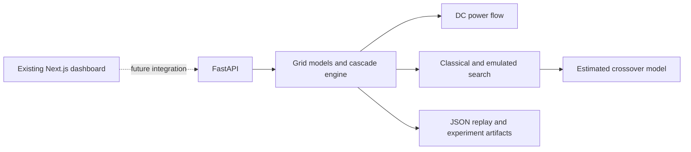

# Grid Doomsday Finder

A reproducible engineering prototype for constrained exactly-k outage search under a deterministic quasi-steady-state cascade model. The existing Next.js dashboard is preserved unchanged; the Python backend is independently runnable.

## Quick start

Linux/macOS:
```bash
python -m venv .venv && . .venv/bin/activate
pip install -e 'backend[test]'
pytest -q backend/tests
uvicorn grid_doomsday.api.main:app --app-dir backend/src --reload
```
Windows PowerShell: `py -m venv .venv; .venv\\Scripts\\Activate.ps1; pip install -e 'backend[test]'; pytest -q backend/tests`
Windows CMD: `py -m venv .venv && .venv\\Scripts\\activate.bat && pip install -e "backend[test]" && pytest -q backend/tests`

The frontend remains the existing Next.js app (`pnpm dev`). The backend smoke fixture is a five-bus ring and is labelled as a fixture, not a measured grid result. IEEE adapters, AC Newton-Raphson, Qiskit circuits, and full E0-E16 runs remain pending and are not fabricated.

## Architecture


## Evidence policy
`IMPLEMENTED` means code exists; `EMULATED` means exact classical dynamics; `ESTIMATED` means analytical resource model; `DESIGN-STAGE` and `PROPOSED` are not results. No quantum speedup, AC fidelity, or real blackout prediction is claimed.

## API
See `docs/api-reference.md`. Example: `curl -X POST http://localhost:8000/cascade -H 'content-type: application/json' -d '{"case":"toy","outages":[0,1]}'`.

## Roadmap
Add documented pandapower/MATPOWER case adapters, AC verification, structured baselines, Qiskit Tier A circuits, full experiment manifests, and the later authorised frontend integration. These are intentionally separated from the frozen frontend.
